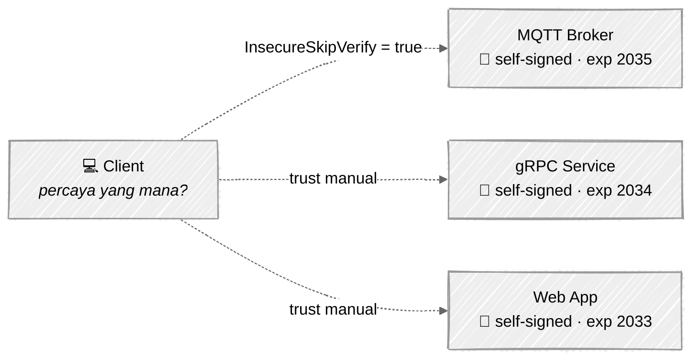
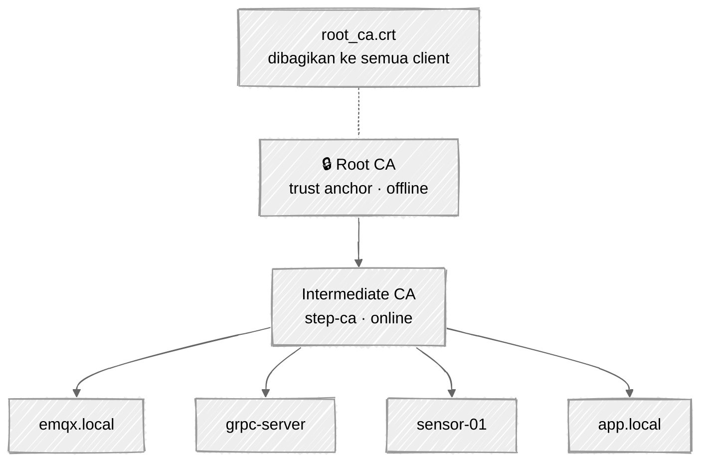
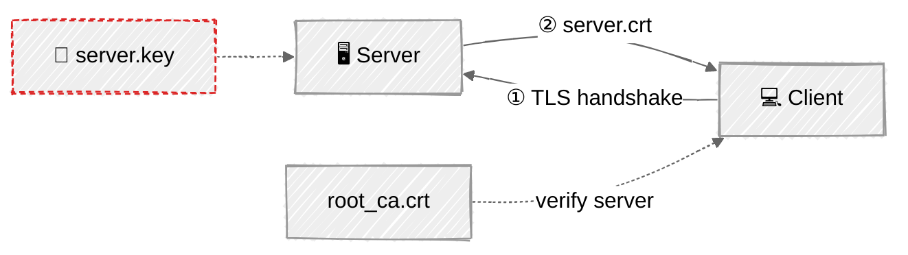
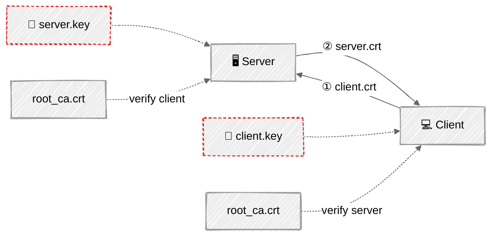
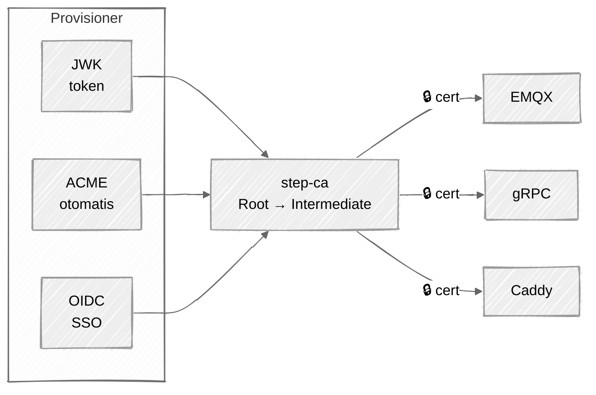
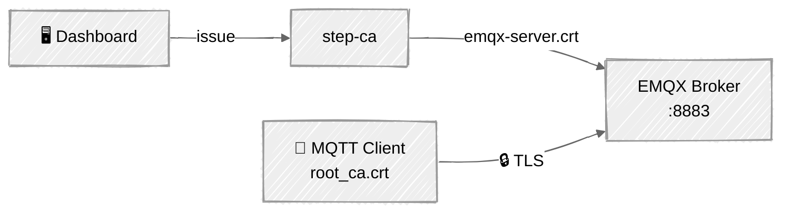
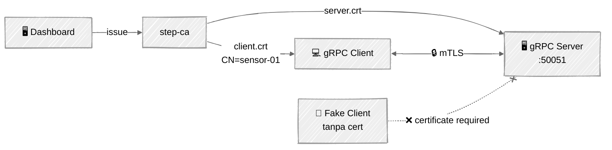
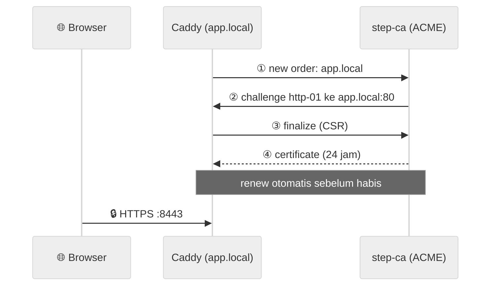

# Slide: Private PKI with step-ca

> Draft konten carousel LinkedIn — style mengikuti deck "Creating a secure MQTT protocol".
> Format 4:5 (800×1000). Cover navy + judul monospace putih, slide isi putih polos.
> Bagian bertanda **[Visual]** = gambar, bukan teks slide. Diagram ditulis dalam **mermaid** (`look: handDrawn`,
> mirip Excalidraw): render di https://mermaid.live atau preview VS Code, lalu screenshot.
> Output terminal di bawah adalah hasil asli dari lab `example/` (boleh di-screenshot ulang).

---

## Slide 1 — Cover

**Judul (monospace, putih, background navy):**

```
Building a Private PKI with step-ca
```

**[Visual]** Dua logo di tengah: logo **smallstep / step-ca** + ikon sertifikat/gembok (seperti badge SSL di deck sebelumnya).

---

## Slide 2 — Intro

**Intro**

Hampir semua komunikasi modern bergantung pada sertifikat: HTTPS, MQTT over TLS, sampai komunikasi antar-service dengan gRPC. Untuk website publik kita punya Let's Encrypt. Tapi bagaimana dengan **service internal**, seperti broker IoT, microservice, atau dashboard di jaringan kantor?

Sering kali jawabannya adalah sertifikat *self-signed* yang dibuat sekali dengan openssl, berlaku 10 tahun, lalu dilupakan. Atau lebih parah lagi: verifikasi sertifikat dimatikan dengan `InsecureSkipVerify`.

Kali ini saya akan berbagi cara membangun **PKI sendiri** untuk kebutuhan internal menggunakan step-ca, beserta contoh implementasinya. Mari kita bahas! 👇

---

## Slide 3 — Problem

**Problem**

**[Visual]**



Masalahnya, tanpa PKI internal setiap service mengurus sertifikatnya sendiri. Client harus memercayai sertifikat satu per satu, atau menyerah dan mematikan verifikasi, sehingga enkripsi tetap jalan tetapi identitas server tidak pernah benar-benar diperiksa.

- Sertifikat *self-signed* tersebar dan harus didistribusikan manual ke setiap client.
- Masa berlaku panjang tanpa inventaris: tidak ada yang tahu kapan habis atau siapa pemiliknya.
- Verifikasi sering dimatikan, sehingga terbuka celah *man-in-the-middle*.

---

## Slide 4 — Apa itu PKI?

**Public Key Infrastructure**

**[Visual]**



PKI adalah sistem untuk menerbitkan dan mengelola sertifikat lewat sebuah *Certificate Authority* (CA). Kuncinya adalah **rantai kepercayaan**: client cukup memercayai satu Root CA, maka semua sertifikat yang diterbitkan dari rantai tersebut otomatis dipercaya.

- **Root CA:** jangkar kepercayaan, kuncinya disimpan *offline*.
- **Intermediate CA:** dipakai sehari-hari untuk menandatangani sertifikat.
- **Leaf certificate:** identitas setiap server, service, atau device.

---

## Slide 5 — TLS vs mTLS

**TLS vs mTLS**

**[Visual]** Dua diagram ditumpuk atas–bawah. Garis putus-putus = verifikasi dengan root CA, kotak 🔑 bergaris merah = rahasia (tidak pernah dikirim).

TLS (satu arah), contoh: EMQX, Caddy



mTLS (dua arah), contoh: gRPC



Dengan PKI yang sama, ada dua cara memakai sertifikat. Perbedaannya hanya pada **siapa yang wajib membuktikan identitas** saat *handshake*:

- **TLS:** hanya server yang menunjukkan sertifikat. Client memverifikasinya dengan `root_ca.crt`, sehingga jalur terenkripsi dan server terbukti asli.
- **mTLS:** server **dan** client sama-sama menunjukkan sertifikat. Server menolak client yang tidak punya sertifikat dari CA yang sama.
- **Kapan dipakai:** TLS untuk web atau API publik; mTLS untuk komunikasi antar-service dan device IoT yang identitasnya harus dipastikan.

---

## Slide 6 — Solution: step-ca

**Solution**

**[Visual]**



Solusinya adalah menjalankan **Private CA** sendiri dengan **step-ca**, yaitu Certificate Authority *open source* dari Smallstep. step-ca bisa dijalankan dengan satu container Docker dan menyediakan API untuk menerbitkan, memperbarui, dan mengelola sertifikat.

- **Provisioner** sebagai pintu masuk penerbitan: JWK (token), ACME (otomatis seperti Let's Encrypt), OIDC (login SSO), dan lainnya.
- **Sertifikat berumur pendek** (default 24 jam) dengan *renew* otomatis, sehingga key yang bocor cepat kedaluwarsa dengan sendirinya.
- Satu `root_ca.crt` untuk semua client, tidak perlu lagi mendistribusikan sertifikat satu per satu.

---

## Slide 7 — Dashboard

**Dashboard**

**[Visual]** Screenshot dashboard (`docs/screenshot.png`): tab **Issue** dengan Deployment Guide, atau tab **Certificates** yang menampilkan `emqx.local`, `grpc-server`, `sensor-01` beserta badge masa berlaku.

Supaya tidak perlu menghafal perintah CLI, saya membuat dashboard sederhana (Go + Svelte) di atas API step-ca. Semua sertifikat pada contoh berikutnya diterbitkan melalui dashboard ini.

- **Issue:** isi *Common Name* dan SAN, lalu private key dan CSR dibuat di sisi dashboard dan ditandatangani step-ca.
- **Certificates:** daftar sertifikat beserta sisa masa berlaku, plus tombol *download* dan *renew*.
- **Provisioners:** tambah atau hapus pintu masuk penerbitan langsung lewat Admin API.

---

## Slide 8 — Use Case 1: EMQX + TLS

**Use Case: MQTT Broker (TLS)**

**[Visual]**



Penerapan paling sederhana adalah **TLS satu arah**. Broker EMQX memakai sertifikat yang diterbitkan step-ca melalui dashboard, sedangkan client cukup memegang `root_ca.crt` untuk memastikan ia terhubung ke broker yang asli.

1. **Server:** EMQX memasang `emqx-server.crt` + `emqx-server.key` di listener `:8883`.
2. **Client:** memverifikasi broker dengan `root_ca.crt`, lalu seluruh *topic* dan *payload* terenkripsi.

**Hasil Percobaan:**

**[Visual]** Screenshot terminal gelap (macOS, 3 titik):

```
$ mosquitto_pub -h emqx -p 8883 --cafile root_ca.crt \
    -t poc/sensor/device01 -m '{"temperature":27.4}' -d
Client null sending CONNECT
Client (null) received CONNACK (0)
Client null sending PUBLISH (d0, q0, r0, m1, 'poc/sensor/device01', ... (20 bytes))
Client null sending DISCONNECT
```

---

## Slide 9 — Use Case 2: gRPC + mTLS

**Use Case: gRPC Service (mTLS)**

**[Visual]**



Untuk komunikasi antar-service, kita butuh lebih dari sekadar enkripsi: server juga harus tahu **siapa** yang memanggil. Dengan **mutual TLS**, client wajib menunjukkan sertifikat dari step-ca, dan server membaca identitasnya dari *Common Name* (CN), tanpa API key atau password.

1. **Server:** `tls.RequireAndVerifyClientCert` dengan `root_ca.crt` sebagai trust anchor.
2. **Client:** mengirim `client.crt` saat *handshake*, dan client tanpa sertifikat ditolak sebelum RPC dijalankan.

**Hasil Percobaan:**

**[Visual]** Screenshot terminal:

```
$ make client
reply: hello sensor-01, authenticated as CN=sensor-01

$ make client-nocert
SayHello: rpc error: code = Unavailable desc = connection error:
  desc = "error reading server preface: remote error: tls: certificate required"
```

---

## Slide 10 — Use Case 3: Caddy + ACME

**Use Case: Web Server (ACME)**

**[Visual]**



Bagaimana kalau tidak ingin mengurus file sertifikat sama sekali? step-ca mendukung protokol **ACME**, protokol yang sama dengan Let's Encrypt. Web server seperti Caddy cukup diarahkan ke step-ca, lalu sertifikat diterbitkan dan diperbarui otomatis.

1. **Konfigurasi:** di Caddyfile, `tls { ca https://step-ca:9000/acme/acme/directory }`.
2. **Otomatis:** Caddy menyelesaikan *challenge*, menerima sertifikat 24 jam, dan memperbaruinya sendiri sebelum habis.

**Hasil Percobaan:**

**[Visual]** Screenshot terminal:

```
$ docker logs caddy | grep 'certificate obtained'
"msg":"certificate obtained successfully","identifier":"app.local",
"issuer":"step-ca:9000-acme-acme-directory"

$ curl --cacert root_ca.crt https://app.local:8443
Hello from Caddy, certificate issued automatically by step-ca via ACME

$ openssl s_client -connect app.local:8443 | openssl x509 -noout -issuer -dates
issuer=O=Step CA Local, CN=Step CA Local Intermediate CA
notBefore=Nov  3 07:38:24 2026 GMT
notAfter=Nov  4 07:39:24 2026 GMT
```

---

## Slide 11 — Conclusion

**Conclusion**

Sebagai kesimpulan, Private PKI dengan step-ca membuat pengelolaan sertifikat internal menjadi terpusat dan bisa diotomasi:

- **TLS (EMQX):** Server membuktikan identitasnya, client cukup memercayai satu `root_ca.crt`.
- **mTLS (gRPC):** Kedua sisi saling membuktikan identitas, dan sertifikat menggantikan API key atau password.
- **ACME (Caddy):** Sertifikat diterbitkan dan diperbarui otomatis, tanpa campur tangan manual.

*Ingin mendalami implementasinya? Silakan kunjungi tautan Github yang saya sertakan di slide terakhir, termasuk setup step-ca dengan Docker, source code dashboard, dan ketiga contoh di atas.*

---

## Slide 12 — Resource

**Resource**

https://github.com/skyapps-id/<nama-repo-step-ca>

Author:
https://www.linkedin.com/in/aji-indra-jaya/

---

## Checklist sebelum publish

- [ ] Ganti `<nama-repo-step-ca>` dengan URL repo yang benar
- [ ] Screenshot terminal asli (atau pakai output di atas): `example/emqx`, `example/grpc` (`make client` / `make client-nocert`), `example/caddy`
- [ ] Screenshot dashboard untuk Slide 7, idealnya tab Certificates setelah menjalankan contoh emqx & grpc
