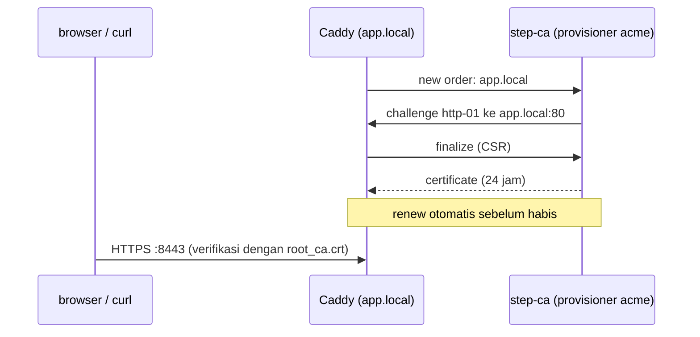

# Caddy + ACME dengan step-ca

Web server Caddy yang **meminta dan memperbarui sertifikat HTTPS sendiri** dari
step-ca melalui protokol ACME, sama seperti dengan Let's Encrypt, tapi untuk
domain internal. Tidak ada file sertifikat yang perlu diterbitkan atau di-copy manual.



## Prasyarat di step-ca (sekali saja)

1. **Provisioner ACME.** Dashboard hanya membuat provisioner JWK, jadi pakai CLI:

   ```bash
   docker exec step-ca step ca provisioner add acme --type ACME \
     --admin-subject step --admin-provisioner admin \
     --admin-password-file /home/step/secrets/password \
     --ca-url https://localhost:9000 --root /home/step/certs/root_ca.crt
   ```

2. **SAN `step-ca` di sertifikat CA.** Caddy menghubungi CA lewat nama container
   `step-ca`, jadi nama itu harus ada di `dnsNames` pada `data/step/config/ca.json`:

   ```json
   "dnsNames": ["localhost", "step-ca"]
   ```

   lalu `docker compose restart step-ca`. Untuk CA baru, cukup set
   `CA_DNS=localhost,step-ca` di `.env` sebelum `docker compose up`.

## Konfigurasi

[Caddyfile](Caddyfile):

```caddy
app.local {
	tls {
		ca https://step-ca:9000/acme/acme/directory   # ACME directory step-ca
		ca_root /certs/root_ca.crt                    # percayai TLS endpoint step-ca
	}
	respond "Hello from Caddy, certificate issued automatically by step-ca via ACME"
}
```

`tls { ca ... }` harus ditulis per site. Kalau hanya memakai global option
`acme_ca`, Caddy tetap memakai CA internalnya sendiri untuk nama non-publik
seperti `*.local`.

[docker-compose.yml](docker-compose.yml) menggabungkan Caddy ke network
`step-ca_default` dengan alias `app.local`, sehingga step-ca bisa memvalidasi
challenge `http-01` ke container Caddy.

## Jalankan

```bash
cd example/caddy
docker exec step-ca cat /home/step/certs/root_ca.crt > certs/root_ca.crt
docker compose up -d
```

## Test

```bash
curl --resolve app.local:8443:127.0.0.1 --cacert certs/root_ca.crt https://app.local:8443
# Hello from Caddy, certificate issued automatically by step-ca via ACME

docker logs caddy 2>&1 | grep 'certificate obtained'
# ... "identifier":"app.local","issuer":"step-ca:9000-acme-acme-directory"

echo | openssl s_client -connect 127.0.0.1:8443 -servername app.local 2>/dev/null \
  | openssl x509 -noout -issuer -dates
# issuer=O=Step CA Local, CN=Step CA Local Intermediate CA
```

Sertifikat berlaku 24 jam, dan Caddy memperbaruinya otomatis sebelum habis.
Supaya browser tidak memberi peringatan, import `root_ca.crt` ke trust store OS
(atau `step certificate install root_ca.crt`).

## Troubleshooting

| Gejala | Penyebab | Solusi |
|---|---|---|
| Log `"issuer":"local"` | Caddy memakai CA internal | Pastikan blok `tls { ca ... }` ada di site |
| `x509: certificate is valid for localhost, not step-ca` | SAN CA belum memuat `step-ca` | Lihat prasyarat no. 2 |
| Challenge gagal / `connection refused` | step-ca tidak bisa menjangkau `app.local:80` | Pastikan Caddy ada di network `step-ca_default` dengan alias `app.local` |
| `unable to get local issuer certificate` di curl | Client tidak memakai root step-ca | Tambahkan `--cacert certs/root_ca.crt` |
