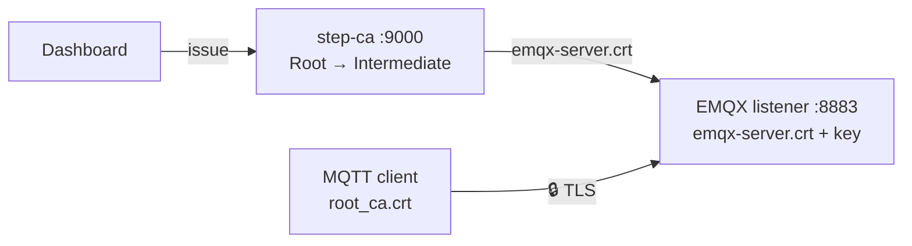

# EMQX + TLS dengan step-ca

Broker MQTT EMQX dengan **TLS satu arah**: broker membuktikan identitasnya dengan
sertifikat dari step-ca, client cukup memegang `root_ca.crt` untuk memverifikasinya.
Seluruh topic dan payload terenkripsi di jalur.



| Sisi | Butuh | Fungsi |
|---|---|---|
| EMQX | `emqx-server.crt` + `emqx-server.key` | Identitas broker. `.crt` sudah bundle leaf + intermediate |
| Client | `root_ca.crt` | Trust anchor untuk memverifikasi broker |

> Butuh broker yang juga memverifikasi **identitas client**? Itu mTLS, lihat
> contoh [gRPC + mTLS](../grpc/README.md). Di EMQX cukup tambahkan
> `cacertfile = ".../ca-chain.crt"`, `verify = verify_peer`,
> `fail_if_no_peer_cert = true` di `ssl_options`.

## 1. Terbitkan sertifikat broker

Dari folder `example/`, lewat API dashboard (step-ca + dashboard harus jalan, lihat [prasyarat](../README.md)):

```bash
./gen-cert.sh emqx/certs emqx-server emqx.local emqx localhost 127.0.0.1
```

SAN harus memuat hostname yang dipakai client untuk terhubung (`localhost` dari
host, `emqx` dari container lain di network yang sama).

Hasil di `emqx/certs/`:

```
emqx-server.crt   # bundle leaf + intermediate, dikirim ke client saat handshake
emqx-server.key
root_ca.crt       # dibagikan ke semua client
ca-chain.crt      # intermediate + root (hanya dipakai kalau mengaktifkan mTLS)
```

## 2. Konfigurasi EMQX

[emqx.conf](emqx.conf) (EMQX 5.x):

```hocon
listeners.ssl.default {
  bind = "0.0.0.0:8883"
  ssl_options {
    certfile = "/opt/emqx/etc/certs/emqx-server.crt"
    keyfile  = "/opt/emqx/etc/certs/emqx-server.key"
    verify = verify_none     # TLS satu arah: client tidak diminta sertifikat
  }
}
```

Listener `1883` (plain text) sengaja dibiarkan untuk perbandingan sniffing.

## 3. Jalankan

```bash
docker compose -f emqx/docker-compose.yml up -d
```

Port: `1883` (plain), `8883` (TLS), `18083` (dashboard, login default `admin/public`).

## 4. Test

```bash
# TLS — client memverifikasi broker dengan root CA
mosquitto_pub -h localhost -p 8883 --cafile emqx/certs/root_ca.crt \
  -t poc/sensor/device01 -m '{"temperature":27.4}' -d

# Tanpa mosquitto di host — jalankan dari container di network yang sama
docker run --rm --network emqx_default -v "$PWD/emqx/certs:/c:ro" eclipse-mosquitto:2 \
  mosquitto_pub -h emqx -p 8883 --cafile /c/root_ca.crt -t poc/sensor/device01 -m hello -d
```

Bandingkan dengan sniffing kedua port:

```bash
sudo tcpdump -i en0 -A -s0 'port 1883'   # topic & payload terbaca
sudo tcpdump -i en0 -A -s0 'port 8883'   # hanya ciphertext
```

## Troubleshooting

| Gejala | Penyebab | Solusi |
|---|---|---|
| `certificate verify failed` | Client tidak memakai root yang benar / hostname tidak ada di SAN | Pakai `--cafile root_ca.crt` dan host yang ada di SAN |
| Port 8883 tidak terbuka | EMQX gagal memuat cert | `docker logs emqx`, biasanya path cert salah |
| Cert baru tidak terpakai | EMQX belum memuat ulang | `docker restart emqx` |

## Renewal

Sertifikat tercatat di dashboard, jadi renew bisa lewat tab **Certificates →
⟳ Renew**, atau API-nya langsung (serial ada di output `gen-cert.sh`):

```bash
# renew menghasilkan serial BARU — pakai serial itu untuk download
NEW=$(curl -s -X POST http://localhost:8080/api/certificates/<serial>/renew \
  | python3 -c 'import json,sys; print(json.load(sys.stdin)["serial"])')
curl -o emqx/certs/emqx-server.crt http://localhost:8080/api/certificates/$NEW/download/crt
docker restart emqx
```

Renew step-ca memakai cert + key lama sebagai bukti (mTLS ke `/renew`), jadi
private key tidak berubah. Untuk produksi, renew sebaiknya dijalankan otomatis
(cron / `step ca renew --daemon`) di samping broker.
