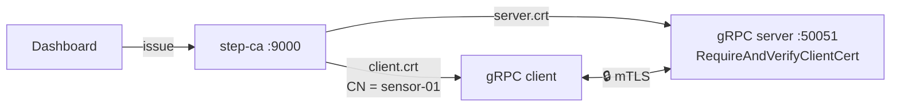

# gRPC + mTLS dengan step-ca

Service gRPC (Go) yang hanya menerima client dengan sertifikat dari step-ca.
Kedua sisi saling membuktikan identitas (**mutual TLS**), dan server membaca
identitas client dari *Common Name* (CN) sertifikatnya, tanpa API key atau password.



| Sisi | File | Fungsi |
|---|---|---|
| Server | `server.crt` + `server.key` | Identitas server (SAN `localhost`) |
| Server | `root_ca.crt` | Memverifikasi client cert |
| Client | `client.crt` + `client.key` | Identitas client (CN `sensor-01`) |
| Client | `root_ca.crt` | Memverifikasi server cert |

## Struktur

```
grpc/
├── proto/greeter.proto     # service Greeter.SayHello
├── greeterpb/              # kode hasil generate (protoc)
├── server/main.go          # tls.RequireAndVerifyClientCert + baca CN dari peer
├── client/main.go          # kirim client cert, flag -no-cert untuk simulasi ditolak
└── Makefile
```

Inti konfigurasi server ([server/main.go](server/main.go)):

```go
creds := credentials.NewTLS(&tls.Config{
	Certificates: []tls.Certificate{cert},     // server.crt (bundle leaf + intermediate)
	ClientAuth:   tls.RequireAndVerifyClientCert, // inilah yang membuatnya mTLS
	ClientCAs:    roots,                      // root_ca.crt
	MinVersion:   tls.VersionTLS13,
})
```

Identitas client diambil dari rantai yang sudah diverifikasi:

```go
info := p.AuthInfo.(credentials.TLSInfo)
cn := info.State.VerifiedChains[0][0].Subject.CommonName
```

## Jalankan

step-ca dan dashboard harus jalan (lihat [prasyarat](../README.md)). `make certs`
menerbitkan sertifikat lewat API dashboard, jadi keduanya muncul di tab Certificates.

```bash
cd example/grpc
make certs          # via dashboard: server.crt (grpc-server, SAN localhost) + client.crt (sensor-01)
make server         # terminal 1
make client         # terminal 2 → diterima
make client-nocert  # terminal 2 → ditolak
```

Hasil:

```
# make client
reply: hello sensor-01, authenticated as CN=sensor-01

# make client-nocert
SayHello: rpc error: code = Unavailable desc = connection error:
  desc = "error reading server preface: remote error: tls: certificate required"
```

Device lain cukup diterbitkan cert dengan CN berbeda:

```bash
../gen-cert.sh certs client sensor-02
```

## Catatan

- `make proto` hanya perlu dijalankan kalau `greeter.proto` diubah (butuh `protoc`,
  `protoc-gen-go`, `protoc-gen-go-grpc`).
- Otorisasi per device (mis. hanya `sensor-*` yang boleh memanggil RPC tertentu)
  bisa ditambahkan sebagai interceptor yang memeriksa CN di atas.
- Sertifikat berlaku 24 jam. Untuk produksi, renew otomatis dengan
  `step ca renew --daemon` dan muat ulang cert tanpa restart lewat
  `tls.Config.GetCertificate`.
